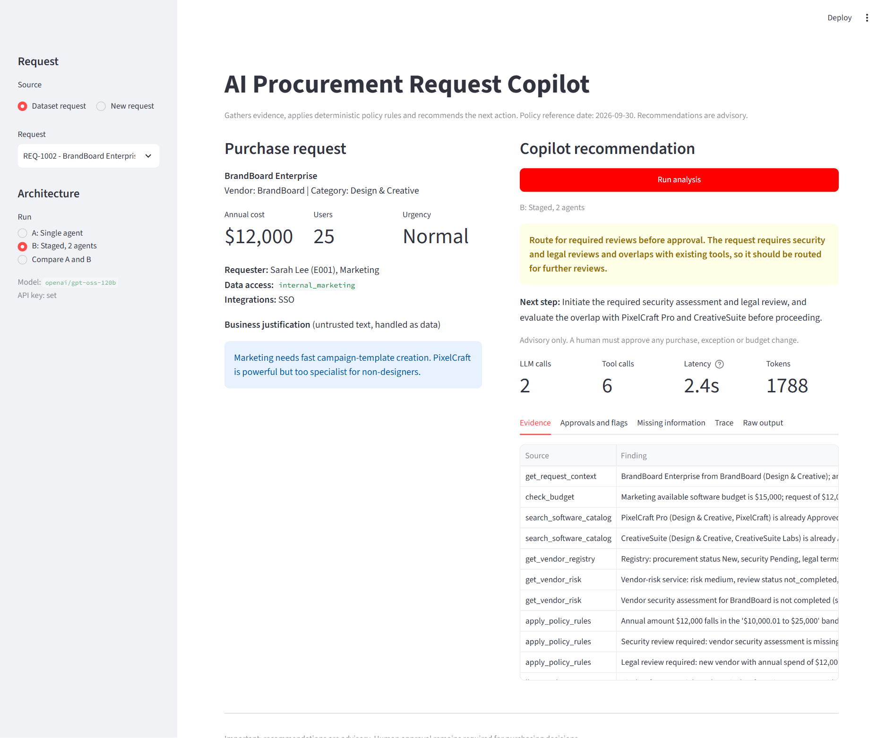
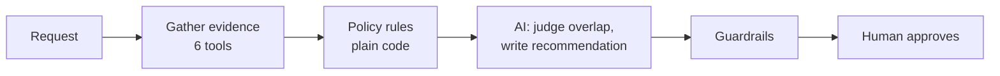
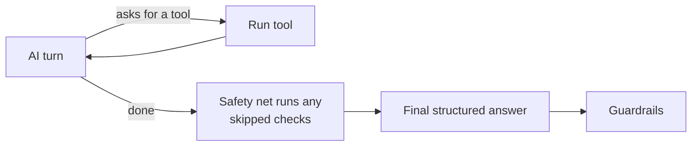
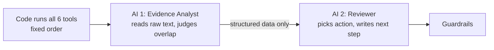

<div align="center">

# AI Procurement Request Copilot

**Checks a software purchase request in seconds, shows its evidence, and recommends the next step.**
A human always makes the final call.


[Run it](#run-it) · [How it works](#how-it-works) · [Architecture](#architecture) · [Results](#test-results) · [Ship decision](#which-one-would-i-ship) · [Limits](#known-limitations)

</div>



## The idea

Employees ask to buy software. Procurement then has to check what the company already owns, whether there is budget, whether the vendor is safe, and who must sign off. This tool does that checking and hands a person a clean evidence pack.

> [!IMPORTANT]
> The copilot cannot buy, approve or change a budget. It has no tool that can. It only recommends.

It comes in two versions, so we can test which is better:

| | A: Single agent | B: Staged (2 agents) |
|---|---|---|
| Who picks the checks | The AI, on the fly | Code, same order every time |
| AI involvement | One AI does everything | One AI reads the evidence, a second writes the recommendation |

All companies, vendors, people and prices here are made up for the assessment.

## Run it

You need Python 3.11+ and a free [Groq](https://console.groq.com) API key.

```bash
python -m venv .venv
source .venv/bin/activate          # Windows: .\.venv\Scripts\Activate.ps1
pip install -r requirements.txt
cp .env.example .env               # Windows: Copy-Item .env.example .env, then add GROQ_API_KEY
python run_local.py                # vendor API + app at http://127.0.0.1:8501
```

<details>
<summary>More commands</summary>

```bash
python verify_setup.py                                    # health check, no key needed
python -m unittest discover -s tests                      # 66 offline tests
python evals/run_public_evals.py --architecture staged    # the six public cases
python evals/run_comparison.py                            # full A vs B comparison (slow on the free tier)
```

No key? The app still works. It falls back to plain rules and says so.

</details>

## How it works

1. **Pick** a request, or type a new one in the sidebar.
2. **Choose** A, B, or compare both side by side, then press **Run analysis**.
3. **Read** the recommendation and next step, then open the tabs for evidence, approvals and risk flags, missing information, and a trace of every check and AI call.

Every answer contains: recommendation, evidence, approvals required, missing information, risk flags and next step.

## Architecture

The rule of thumb: **code does the rules, AI does the reading, humans do the deciding.**

| Code (same answer every time) | AI | Humans |
|---|---|---|
| Approval levels, budget check, which reviews are needed, expiry dates, source conflicts, spotting injected instructions | Does an existing tool already cover this? Which allowed action fits? Plain-English summary | Every approval, exception and budget change |



**A: the AI chooses its own checks**



**B: fixed checks, then two narrow AIs**



**Tools** (shared by both): `get_request_context`, `check_budget`, `search_software_catalog`, `get_vendor_registry`, `get_vendor_risk` (calls the mock vendor API) and `apply_policy_rules`. Five are plain lookups or code, so the "at least one non-AI tool" rule is met easily.

**Guardrails:** the AI cannot remove an approval or flag, can only pick actions the rules allow, must cite real catalog items, and any wording that sounds like "approved" is replaced. If the AI or the vendor API is down, the tool says what it could not verify and sends the case to a human instead of guessing.

More detail on failure handling and assumptions: [`docs/architecture.md`](docs/architecture.md).

## Test results

26 cases: the 10 dataset requests plus 16 tricky ones I built (exact threshold amounts, a review 365 vs 366 days old, instructions hidden in vendor notes, an API timeout, an unknown requester, and more). The expected answers were written by hand from the policy. Same cases for both versions, model `openai/gpt-oss-20b`.

| | Rules only | A: Single agent | B: Staged |
|---|---:|---:|---:|
| Cases fully correct | 25/26 | 23/26 | **26/26** |
| Right approvals | 100% | 100% | 100% |
| Right next action | 96% | 92% | 100% |
| Right risk flags | 100% | 88% | 100% |
| AI calls per request | 0 | 4.9 | **2.0** |
| Tokens per request | 0 | 3,799 | **1,547** |
| Time per request¹ | under 0.1 s | 4.7 s | **1.8 s** |

¹ Excluding waiting caused by the free tier's rate limits.

A larger model (`gpt-oss-120b`, 7 cases) passed both, but A needed 8 AI calls to B's 2.

What this shows:

- ✅ Approvals were right everywhere, because they come from code, not AI.
- ⚠️ A's agent skipped about 3 of the 6 required checks in every run. A safety net had to run them for it.
- ⚠️ A called an add-on to an existing product a "duplicate" three times. B did not.
- B costs less than half as much and was never worse.

Per-case results are in [`evals/results/`](evals/results/).

## Which one would I ship?

> [!TIP]
> Ship **B, the staged version.**

The checks are the same for every request, so letting an AI choose them only adds cost and mistakes. B is cheaper, faster and got more cases right. It also keeps the part that reads untrusted text apart from the part that writes the recommendation. The 500-word memo is in [`docs/architecture_decision_memo.md`](docs/architecture_decision_memo.md).

## Assumptions

- Dates are checked against **2026-09-30** (from the policy file), never today's date.
- A vendor review is valid for 365 days, counting the 365th day. Amount bands include their upper limit, so $10,000 exactly is the lower band.
- Overlap is flagged for the same category or the same product. Same vendor in another category is information only.
- If the vendor API is down, the internal registry's "Approved" is not trusted alone, because it can be out of date.
- An incomplete request gets no approval chain, only a request for the missing details.
- `internal_documents` counts as non-sensitive. Confidential documents, source code, PII, credentials and production access are sensitive.

## Known limitations

- Small test set, one run per case, and the expected answers are my own reading of the policy. An independent reviewer would make it stronger.
- Groq's free tier allows 200,000 tokens per day per model, which limited repeats and the second-model test.
- I did not test a one-AI-call version of B, so the value of the second agent is unproven.
- No usage data exists, so "unused licences" cannot be checked.
- Injection detection is pattern based plus an AI check. A cleverly reworded attack might not be flagged, though it still cannot change approvals.
- Built for one user on a laptop: no queue, saved state or circuit breaker yet.

## What is where

| Path | What |
|---|---|
| `app.py` | The UI |
| `src/policy.py` | The rules |
| `src/tools.py` | The 6 tools |
| `src/agents.py` | Versions A and B |
| `src/pipeline.py` | Guardrails and output |
| `src/solution.py` | `handle_request` adapter |
| `evals/` | Cases, runners, results |
| `tests/`, `docs/` | Tests; architecture and memo |
