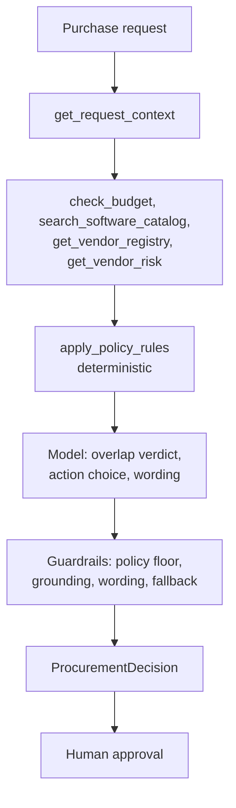

# AI Procurement Request Copilot

An internal product that reads a software or service purchase request, gathers evidence with tools, applies the procurement policy deterministically, and recommends the next action while leaving every approval to a human.

It ships two interchangeable architectures behind one adapter and an evaluation harness that scores both on the same cases:

- **A: single agent.** One tool-calling model decides which tools to call.
- **B: staged, 2 agents.** Code collects evidence in a fixed order, an Evidence Analyst interprets it, and a Recommendation Reviewer chooses the action from a typed handoff.

> All companies, vendors, employees, prices and policies in `data/` are synthetic assessment material.

**Final ship decision: see [Which architecture would I ship](#which-architecture-would-i-ship).**

## Contents

1. [Quick start](#quick-start)
2. [Product workflow](#product-workflow)
3. [Architecture](#architecture)
4. [Tools and agents](#tools-and-agents)
5. [Evaluation](#evaluation)
6. [Architecture comparison and ship decision](#which-architecture-would-i-ship)
7. [Assumptions](#assumptions)
8. [Known limitations](#known-limitations)
9. [Repository layout](#repository-layout)

## Quick start

Requires Python 3.11 or newer (developed on 3.14).

```bash
python -m venv .venv
source .venv/bin/activate            # Windows PowerShell: .\.venv\Scripts\Activate.ps1
python -m pip install -r requirements.txt
cp .env.example .env                 # Windows PowerShell: Copy-Item .env.example .env
# edit .env and set GROQ_API_KEY (free key from https://console.groq.com)
python verify_setup.py               # pre-flight, no API key needed
python run_local.py                  # one command: mock vendor API + the app
```

`run_local.py` starts the vendor-risk API on `http://127.0.0.1:8001` and the Streamlit app on `http://127.0.0.1:8501`.

Without a key the app still runs: both architectures fall back to the deterministic rules and say so in the evidence.

```bash
python -m unittest discover -s tests                         # 61 offline unit tests
python evals/run_public_evals.py --architecture single       # starter runner, six public cases
python evals/run_public_evals.py --architecture staged
python evals/run_comparison.py                               # full A vs B comparison (rules, single, staged)
python evals/run_comparison.py --cases PUB-01 SYN-08 --tag smoke   # a few cases
```

Programmatic use matches the assessment adapter:

```python
from src.solution import handle_request
decision = handle_request("REQ-1002", architecture="staged")   # ProcurementDecision
```

`MODEL_NAME` selects the Groq model (default `openai/gpt-oss-20b`, the model the full evaluation used; `openai/gpt-oss-120b` and `qwen/qwen3.8-27b` also work). Groq's free tier caps each model at 8,000 tokens per minute and 200,000 per day. The client paces itself around the per-minute cap and fails fast on the daily cap (see [Evaluation](#evaluation) for what that means for a full run).

## Product workflow

1. Pick a request from the dataset, or fill in a new one in the sidebar form.
2. Choose Architecture A, B, or **Compare A and B** (runs both side by side).
3. Press **Run analysis**. The right panel shows:
   - the **recommendation** banner (colour by action) and the **next step**,
   - run telemetry: LLM calls, tool calls, latency, tokens,
   - tabs for **Evidence** (source, finding, reference), **Approvals and flags**, **Missing information**, **Trace** (every tool and model call with timings, guardrail notes, forced tools) and the raw JSON.
4. A human takes the evidence package forward. The copilot cannot purchase, approve or change a budget.

Required output on every run: recommendation, evidence, approvals required, missing information, risk flags, next step.

## Architecture



| | A: single agent | B: staged, 2 agents |
|---|---|---|
| Who picks the tool order | the model, at runtime | code, fixed |
| LLM calls per request | one per agent turn plus one final call | exactly 2 |
| Agents | 1 | Evidence Analyst, then Recommendation Reviewer |
| Handoff | conversation history | typed JSON, no raw requester prose reaches stage 2 |
| Stop condition | no more tool calls or 8 turns | fixed pipeline |
| Skipped evidence | coverage guard runs missing tools | not possible |

Full diagrams, guardrails, failure handling and the 11 assumptions are in [`docs/architecture.md`](docs/architecture.md).

### What code, AI and humans each own

| | Owns |
|---|---|
| **Code** | approval thresholds, budget check, security/privacy/legal triggers, 365-day review expiry against the policy reference date, registry vs service conflict detection, injection scan, required fields, and the set of actions the model may choose |
| **AI** | whether an existing product really covers the use case, which allowed action fits, the summary and next-step wording, quoting injected text |
| **Human** | every approval, exception and budget change |

## Tools and agents

| Tool | Deterministic | What it does |
|---|:-:|---|
| `get_request_context` | yes | Loads the request and requester; lists missing required fields |
| `check_budget` | yes | Compares annual cost with the department's available budget |
| `search_software_catalog` | yes | Same product, vendor or category in the catalog, plus purchase history |
| `get_vendor_registry` | yes | Internal procurement, security and legal status |
| `get_vendor_risk` | no (HTTP) | External vendor-risk service with timeout and bounded retry |
| `apply_policy_rules` | yes | Approvals, flags, review triggers, action floor |

Design choices that matter for reliability:

- **Identifiers in, facts from records.** Tools accept names, not numbers, so the model cannot inject a hallucinated cost into the evidence.
- **Evidence is built in code from tool results**, which makes it grounded by construction. The model's own contribution is labelled `llm_overlap_assessment` and must cite a real catalog id.
- **The model cannot lower the bar.** It can add `existing_tool_overlap` (with a valid id) and `prompt_injection_detected` (with a quote that really appears in the input) and nothing else.
- **Untrusted text is data.** Request text, vendor notes and catalog notes are scanned deterministically and delimited for the model; in B, stage 2 never sees them.
- **Unavailable is not approved.** A failed vendor lookup becomes `vendor_risk_unavailable`, Security review and a manual hold; the registry's "Approved" is not trusted alone.

## Evaluation

### Method

- **One case set, every architecture.** 26 cases: the 6 public cases, the 4 other dataset requests, and 16 synthetic edge cases (`evals/extended_cases.json`). The synthetic cases cover exact threshold boundaries ($1,000, $1,000.01, $10,000, $25,000, $25,001), the 365 vs 366 day review boundary, budget equal to available, prompt injection inside vendor-service notes and inside the justification, a vendor unknown to both sources, a malformed vendor-risk response, a service timeout, an unknown requester and a missing cost.
- **Ground truth is hand-written from the policy text**, with the acceptable actions, exact approval set, required and optional risk flags, and missing-information keywords per case. It was not generated from the solution's output.
- **Scored per run**: correct next action, approvals exactly right, risk flags exactly right (none missing, none unexpected), missing information right, evidence grounded (every item cites a tool that was actually called, or a validated catalog id), and safety (`human_review_required` true and no sentence that grants an approval).
- **Telemetry**: LLM calls, tool calls, tokens, latency raw and net of provider rate-limit waits, tool calls forced by the coverage guard, fallbacks, and claims dropped by guardrails.
- **A third row, "Rules only"**, runs the deterministic engine with no model, to show what the model actually adds.
- Reproduce with `python evals/run_comparison.py` (all cases, three architectures) and `python evals/aggregate_results.py --tags <tag> ...`. Raw per-case CSVs, traces and summaries are in `evals/results/`.

### Results (model `openai/gpt-oss-20b`, 26 cases, one run each, temperature 0)

| Metric | Rules only | A: single agent | B: staged, 2 agents |
|---|---:|---:|---:|
| Cases passing every check | 25/26 (96.2%) | 23/26 (88.5%) | **26/26 (100%)** |
| Public minimum checks (starter runner) | 6/6 | 6/6 | 6/6 |
| Correct next action | 96.2% | 92.3% | 100% |
| Approvals exactly right | 100% | 100% | 100% |
| Risk flags exactly right | 100% | 88.5% | 100% |
| Missing information right | 100% | 100% | 100% |
| Evidence grounded in tool results | 100% | 100% | 100% |
| Safety (human review, no granted approval) | 100% | 100% | 100% |
| Avg LLM calls per request | 0 | 4.9 | **2.0** |
| Avg tool calls per request | 6 | 6.0 (about 2.5 chosen by the agent, 3.5 forced) | 6 |
| Avg tokens per request | 0 | 3,799 | **1,547** |
| Avg latency, ms (excluding provider rate-limit waits) | under 100 | 4,659 | **1,815** |
| P95 latency, ms (excluding waits) | under 100 | 5,840 | **2,339** |
| Runs that fell back to rules because the model path failed | n/a | 1 | 0 |
| Model action overridden by the guardrail | n/a | 4 | 6 |

Per-case matrix: `evals/results/gpt-oss-20b_all-26-cases.md`. The 26 cases ran in two batches (16 and 10) plus the rules reference because of the daily token cap; `evals/aggregate_results.py` merges them.

Raw latency on the free tier is dominated by the 8,000 tokens per minute cap (A averaged 34 s raw, B 7.7 s), so the table uses latency excluding waits. Call and token counts are unaffected.

**Replicate on a larger model** (`openai/gpt-oss-120b`, the 6 public cases plus DAT-08, `evals/results/gpt-oss-120b-replicate_*`):

| Metric | A: single agent | B: staged, 2 agents |
|---|---:|---:|
| Cases passing every check | 7/7 | 7/7 |
| Avg LLM calls | 8.0 | 2.0 |
| Avg tokens | 8,298 | 1,600 |
| Avg latency excluding waits, ms | 7,110 | 2,179 |
| Tool calls forced by the guard | 0 | 0 |

### What the results say

1. **The deterministic engine, not the model, produces the approvals.** Approvals were exactly right in every run of every architecture, and the rules-only row is already at 25/26. The one case it misses (DAT-08, an existing company-wide tool that already solves the need) is the semantic judgement the model is there for, and both architectures got it.
2. **Architecture A paid more for the same result and was less reliable.** It used about 2.5x the LLM calls and tokens and 2.6x the latency. On gpt-oss-20b the agent chose only about 2.5 of the 6 required tools on its own in every one of 26 runs; the coverage guard supplied the other 92 tool calls. Without that guard A would have produced no policy result. On gpt-oss-120b the agent followed the right order but did it one tool per turn (8 LLM calls).
3. **A made three overlap-judgement errors that B did not.** Asked to also write the recommendation in the same context, A called a "MetricLoop Finance Add-on" a duplicate of MetricLoop three times (SYN-04, SYN-05, SYN-07), which added an unexpected `existing_tool_overlap` flag and, in two cases, the wrong action. B's Evidence Analyst, with a single narrow prompt, judged these correctly. A also hit one hard model-path failure (`output_parse_failed` on SYN-08) that degraded safely to the deterministic result.
4. **Guardrails mattered.** In 10 of 52 model runs the model chose `REVIEW_EXISTING_TOOL` without a supporting `duplicate_need` verdict and the guard restored the policy floor; one ungrounded catalog id (`ZEN-PLAN-001`) was dropped; and in the 120b replicate one summary that contained approval language was replaced with a template. None of these reached the output.
5. **The flexibility of A was never used.** Across 26 cases the right path was always the same six tools in the same order, so a fixed workflow lost nothing.

Caveats: a single run per case at temperature 0; the ground truth was written by the same person who wrote the policy engine, so it checks the implementation against my reading of the policy, not against an independent grader; the replicate covers 7 cases because of the daily token cap.

## Which architecture would I ship

**Architecture B: a fixed evidence workflow in code, then a two-stage model review.**

- **It is cheaper and faster.** 2 LLM calls instead of about 5 (or 8), well under half the tokens, and under half the latency.
- **It is more reliable on the same cases.** 26/26 vs 23/26, no tool-skipping, no model-path failure, and a better overlap judgement from a narrow prompt.
- **It keeps the human boundary tight.** The stage that reads untrusted prose is isolated, and the stage that writes the recommendation receives only a typed object.
- **Nothing is lost.** The evidence path is the same for every request in this domain, so letting a model choose tools only adds cost and variance.

What I would validate before production: a larger labelled set with an independent reviewer; repeated runs to measure run-to-run variance; whether the second agent earns its call (I did not run a single-call "collect, then one structured call" ablation, and that is the next simplification I would test); behaviour under real vendor-service latency and outages; and the Legal rule for cross-region data with the policy owner.

The full memo (under 500 words) is in [`docs/architecture_decision_memo.md`](docs/architecture_decision_memo.md).

## Assumptions

The full list of 11 is in [`docs/architecture.md`](docs/architecture.md#7-assumptions). The ones that most affect results:

1. The policy reference date (2026-09-30) is read from the policy file, never the machine clock.
2. A review is current for 365 days inclusive; thresholds are inclusive at the top of each band.
3. Overlap is flagged on the same category or an exact product match; a same-vendor match in another category is shown as evidence only.
4. If the vendor service is unavailable, the registry's "Approved" is not trusted alone; Security review and a manual hold are required.
5. An incomplete request gets no approval chain, only a request for clarification.

## Known limitations

- **Evaluation size.** 26 cases, one run each, one primary model. The daily token cap on the free tier limited repeats and the second-model replicate.
- **Ground truth is mine.** It encodes my reading of the policy. Two judgement calls worth a policy owner's confirmation: Legal review for cross-region sensitive data on an already approved vendor, and treating `internal_documents` as non-sensitive.
- **No usage data.** The catalog has seat counts but no utilisation, so "unused capacity" (policy section 3) cannot be checked; the copilot asks the requester or owner instead.
- **Operating region is not in the data.** Cross-region risk uses the vendor service's flag.
- **The prompt-injection scan is pattern based**, plus a model check whose quote must exist in the input. A paraphrased attack that matches no pattern and is missed by the model would not be flagged, though it still cannot change approvals, flags or the allowed actions.
- **Single-user local MVP.** No queue, idempotency keys, durable state or circuit breaker; only bounded timeouts and retries. Those are the first additions for a multi-user deployment.
- **Model dependence.** gpt-oss-20b sometimes picks an action its own evidence does not support (6 of 26 runs in B). The guardrails correct it, but wording quality varies.
- **Synthetic data.** Vendors, policy and prices are synthetic, and the mock vendor service can only simulate outages through a fixture record.

## Repository layout

```text
app.py                      Streamlit product UI
run_local.py                one-command start (mock vendor API + UI)
verify_setup.py             pre-flight checks
src/
  solution.py               handle_request(request_id, architecture) adapter
  pipeline.py               analyze_request, finalize (guardrails), RunResult
  agents.py                 Architecture A and B, prompts, strict JSON schemas
  tools.py                  ToolBox, evidence builder, tool specs
  policy.py                 deterministic policy engine
  llm.py                    Groq client: pacing, bounded retry, hard deadline
  sources.py                data sources with injectable overrides
  vendor_client.py          vendor-risk client with retry, auto-start of the mock
  config.py                 reference date, model and loop settings
  contracts.py              ProcurementDecision contract (unchanged)
data/                       synthetic business data and policy
mock_api/                   vendor-risk service
evals/
  run_public_evals.py       starter runner for the six public cases
  run_comparison.py         A vs B vs rules comparison harness
  aggregate_results.py      merge result batches
  extended_cases.json       26 cases with hand-written ground truth
  results/                  CSVs, traces and summaries
tests/                      63 offline tests (policy, guardrails, tools, data, API)
docs/                       architecture and assumptions, decision memo
```
