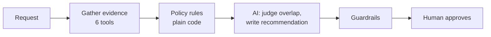

# AI Procurement Request Copilot

Employees ask to buy software. Someone in procurement then has to check what we already own, whether there is budget, whether the vendor is safe, and who needs to sign off. This tool does that checking in seconds and recommends the next step. **A human still approves everything.** The tool cannot buy, approve or change a budget.

It comes in two versions, so we can test which is better:

- **A, single agent:** one AI model decides which checks to run, and in what order.
- **B, staged (2 agents):** code runs the same checks every time, then one AI reads the evidence and a second AI writes the recommendation.

> All companies, vendors, people and prices here are made up for the assessment.

## Run it

You need Python 3.11 or newer and a free [Groq](https://console.groq.com) API key.

```bash
python -m venv .venv
source .venv/bin/activate          # Windows: .\.venv\Scripts\Activate.ps1
pip install -r requirements.txt
cp .env.example .env               # Windows: Copy-Item .env.example .env, then add GROQ_API_KEY
python run_local.py                # starts the vendor API and the app at http://127.0.0.1:8501
```

Other useful commands:

```bash
python verify_setup.py                      # quick health check, no key needed
python -m unittest discover -s tests        # 63 offline tests
python evals/run_public_evals.py --architecture staged   # the six public cases
python evals/run_comparison.py              # full A vs B comparison (slow on the free tier)
```

No key? The app still works. It falls back to the plain rules and tells you so.

## How it works for the user

1. Pick a request, or type a new one in the sidebar.
2. Choose A, B, or compare both side by side, then press **Run analysis**.
3. You get a recommendation and next step, plus tabs for the **evidence**, **approvals and risk flags**, **missing information**, and a **trace** of every check and AI call.

Every answer contains: recommendation, evidence, approvals required, missing information, risk flags and next step.

## Architecture



The idea is simple: **code does the rules, AI does the reading, humans do the deciding.**

| | Done by |
|---|---|
| Approval levels, budget check, which reviews are needed, expiry dates, conflicts, spotting injected instructions | Code (same answer every time) |
| Does an existing tool already cover this? Which allowed next action fits? Plain-English summary | AI |
| Every approval, exception and budget change | Humans |

**Tools** (shared by both versions): `get_request_context`, `check_budget`, `search_software_catalog`, `get_vendor_registry`, `get_vendor_risk` (calls the mock vendor API), and `apply_policy_rules`. Five are plain lookups or code, so the "at least one non-AI tool" rule is easily met.

**Guardrails** keep the AI honest: it cannot remove an approval or flag, can only pick from actions the rules allow, must cite real catalog items, and anything it says that sounds like "approved" is replaced. If the AI or the vendor API is down, the tool says what it could not verify and sends the case to a human instead of guessing.

Diagrams of A and B, failure handling and the full assumptions list are in [`docs/architecture.md`](docs/architecture.md).

## Test results

26 cases: the 10 dataset requests plus 16 tricky ones I built (exact threshold amounts, a review that is 365 vs 366 days old, instructions hidden in vendor notes, a vendor API timeout, an unknown requester, and so on). The expected answers were written by hand from the policy. Same cases for both versions, model `openai/gpt-oss-20b`.

| | Rules only | A: single agent | B: staged |
|---|---:|---:|---:|
| Cases fully correct | 25/26 | 23/26 | **26/26** |
| Right approvals | 100% | 100% | 100% |
| Right next action | 96% | 92% | 100% |
| Right risk flags | 100% | 88% | 100% |
| AI calls per request | 0 | 4.9 | **2.0** |
| Tokens per request | 0 | 3,799 | **1,547** |
| Time per request (excluding free-tier waits) | under 0.1 s | 4.7 s | **1.8 s** |

A second, larger model (`gpt-oss-120b`, 7 cases) passed both, but A needed 8 AI calls to B's 2.

What this shows:

- Approvals were right everywhere because they come from code, not AI.
- A's agent skipped about 3 of the 6 required checks in every run; a safety net had to run them for it.
- A three times called an add-on to an existing product a "duplicate". B did not.
- B costs less than half as much and was never worse.

Full tables and per-case results are in [`evals/results/`](evals/results/).

## Which one would I ship?

**B, the staged version.** In this problem the checks are the same for every request, so letting an AI choose them only adds cost and mistakes. B is cheaper, faster, and got more cases right, and the part that reads untrusted text is kept apart from the part that writes the recommendation. The short memo is in [`docs/architecture_decision_memo.md`](docs/architecture_decision_memo.md).

## Assumptions

- Dates are checked against **2026-09-30** (from the policy file), never today's date.
- A vendor review is valid for 365 days, counting the 365th day. Amount bands include their upper limit (so $10,000 exactly is the lower band).
- Overlap is flagged for the same category or the same product. Same vendor in another category is shown as information only.
- If the vendor API is down, the internal registry's "Approved" is not trusted on its own, because it can be out of date.
- An incomplete request gets no approval chain, only a request for the missing details.
- `internal_documents` is treated as non-sensitive; confidential documents, source code, PII, credentials and production access are sensitive.

## Known limitations

- Small test set, one run per case, and the expected answers are my own reading of the policy. An independent reviewer would make it stronger.
- Groq's free tier allows 200,000 tokens per day per model, which limited repeats and the second-model test.
- I did not test a one-AI-call version of B, so the value of the second agent is unproven.
- No usage data exists, so "unused licences" cannot be checked.
- Injection detection is pattern based plus an AI check. A cleverly reworded attack might not be flagged, though it still cannot change approvals.
- Built for one user on a laptop: no queue, saved state or circuit breaker yet.

## What is where

`app.py` (UI) · `src/policy.py` (rules) · `src/tools.py` (tools) · `src/agents.py` (A and B) · `src/pipeline.py` (guardrails) · `src/solution.py` (`handle_request` adapter) · `evals/` (cases, runners, results) · `tests/` · `docs/`
