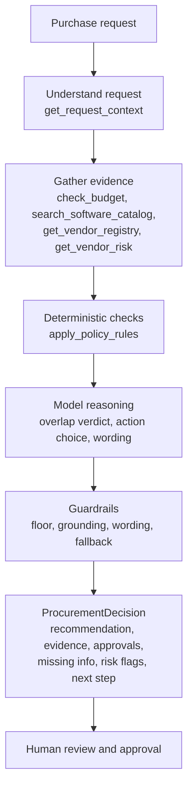
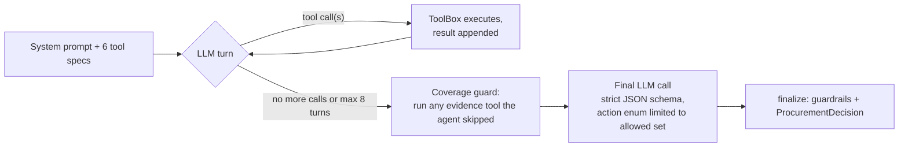
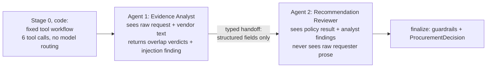

# Architecture, workflow and assumptions

## 1. Who decides what

| Layer | Owns | Never does |
|---|---|---|
| **Code** (`src/policy.py`, `src/tools.py`) | Thresholds, budget comparison, review triggers, 365-day expiry maths, registry vs service conflict detection, prompt-injection scan, required-field checks, the set of actions the model may pick | Judge whether an existing tool really covers a use case |
| **AI** (`src/agents.py`) | Overlap judgement between the request and existing catalog products, choice of next action inside the allowed set, plain-language summary and next step, quoting injected text it spots | Compute approvals or flags, relax a rule, approve or reject anything |
| **Human** | Every approval, exception and budget change; resolving conflicting or missing vendor evidence | Nothing is automated past the recommendation |

`human_review_required` is always `true`. There is no tool that can purchase, approve or edit a budget, so the model physically cannot do those things.

## 2. End-to-end workflow

## 3. The two architectures

### Architecture A: single agent (tool-calling loop)

The model chooses which tools to call and in what order. Stop conditions: no more tool calls, or 8 turns. A final strict-schema call produces the structured decision.

### Architecture B: staged, two agents

Why this split: evidence interpretation is the only step that reads untrusted prose, so it is isolated in Agent 1. Agent 2 receives a typed object, which both limits prompt-injection reach and gives a clean place to review consistency with the policy result.

### Shared by both

- `ToolBox`: the same six tools, trace and counters.
- `finalize()`: the same guardrails and output assembly.
- Same model, same prompts for the guardrail rules, same evaluation set.

## 4. Tools

| Tool | Type | Source | Failure behaviour |
|---|---|---|---|
| `get_request_context` | deterministic | `requests.json`, `employees.csv` | Unknown requester becomes missing information |
| `check_budget` | deterministic | `department_budgets.csv` | Unknown department or cost: "unverifiable", never "within budget" |
| `search_software_catalog` | deterministic | `software_catalog.csv`, `purchase_history.csv` | Empty result is reported explicitly |
| `get_vendor_registry` | deterministic | `vendors.csv` | Missing vendor is treated as new, Security and Legal needed |
| `get_vendor_risk` | external API | mock service on `:8001` | Timeout 3s, 3 attempts with backoff on network/5xx errors only; 404 and malformed bodies are not retried; any failure becomes `vendor_risk_unavailable` and routes to Security |
| `apply_policy_rules` | deterministic | `src/policy.py` | Refuses to run until the five evidence slots are filled |

Tools take identifiers only. The annual cost and other facts are read from the request record, so the model cannot supply an invented number that then becomes "evidence". A lookup fills the official evidence slot only when it matches the request (right department, right vendor); an off-request lookup is returned but ignored for the decision.

## 5. Guardrails in `finalize()`

1. **Policy floor**: approvals, risk flags and missing information come from the policy engine only. The model cannot remove or add them. Its only flag additions are `existing_tool_overlap` (must cite a real catalog id) and `prompt_injection_detected` (the quoted text must actually appear in the input).
2. **Action constrained decoding**: the JSON schema's `recommended_action` enum contains only the actions the policy floor allows. `REVIEW_EXISTING_TOOL` also needs at least one `duplicate_need` assessment, otherwise the floor is used.
3. **Grounded evidence**: evidence items are assembled in code from tool results. Model-authored assessments are labelled `llm_overlap_assessment` and must cite a catalog id from the search result.
4. **Wording guard**: a summary or next step that presents something as approved, rejected or purchased is replaced with a deterministic template.
5. **Coverage guard** (A only): any evidence tool the agent did not call is run by code and counted as `forced`.
6. **Fallback**: if the model is unreachable or returns unusable output, the deterministic recommendation is returned with an evidence line saying the model was unavailable.
7. **Text hygiene**: long dashes are normalised out of model text.

## 6. Failure handling

| Situation | Behaviour |
|---|---|
| Vendor-risk API 503 or timeout | Retries (bounded), then `vendor_risk_unavailable`, Security approval, action `HOLD_FOR_MANUAL_REVIEW` |
| Vendor missing from the risk service (404) | Same as above, with distinct evidence text |
| Registry says Approved, service says expired | `conflicting_vendor_evidence` plus `vendor_review_expired`, hold for manual review |
| Model rate limit (HTTP 429) | Pacing from rate-limit headers plus bounded retry honouring `Retry-After` |
| Model returns malformed or unavailable | Deterministic fallback, no crash |
| Agent hits 8 turns | Coverage guard completes the evidence, run continues |

## 7. Assumptions

1. **Reference date** is read from `data/procurement_policy.md` (2026-09-30) and used for every date check.
2. `annual_cost_usd` is already annualised. A cost equal to the available budget is "within budget".
3. Thresholds are inclusive at the top of each band, exactly as written in the policy table. For example, $10,000 is in the Department Head + Procurement band, while the Legal rule for a new vendor uses "$10,000 or more".
4. A review is current if it is at most 365 days old at the reference date.
5. `internal_documents` and `internal_marketing` are non-sensitive; only the data classes the policy names trigger Security or Privacy. An unrecognised data class is treated as missing information rather than guessed.
6. A vendor is "new" if the registry says `New` or the vendor is absent from the registry.
7. Overlap is flagged on the same category or an exact product match. A same-vendor match in a different category is shown as evidence only, because the policy says overlap is not an automatic rejection.
8. When the vendor service is unavailable, the registry's "Approved" is not trusted on its own, because the registry can be stale (the dataset contains such a case).
9. The operating region is not given in the data, so "stores data outside the operating region" is taken from the vendor-risk service flag.
10. With an incomplete request the approval chain cannot be set, so `required_approvals` is empty and the next step says so.
11. Urgency is recorded but never changes policy.

## 8. Deliberately not built

- Queue, workers, WebSocket push, idempotency store, circuit breaker and durable checkpoints. They are described in the course notes for production scale; this is a single-user local MVP, so bounded timeouts and retries are implemented and the rest is listed as follow-up in the README.
- Any write path (purchase, approval, budget change, vendor-term acceptance).
- A vector store. The catalog has ten rows, so deterministic matching plus a model verdict is simpler and auditable.
